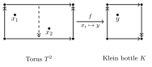
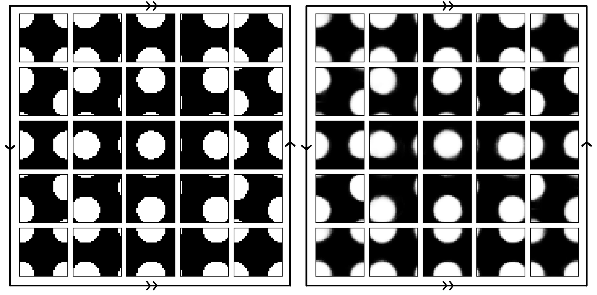
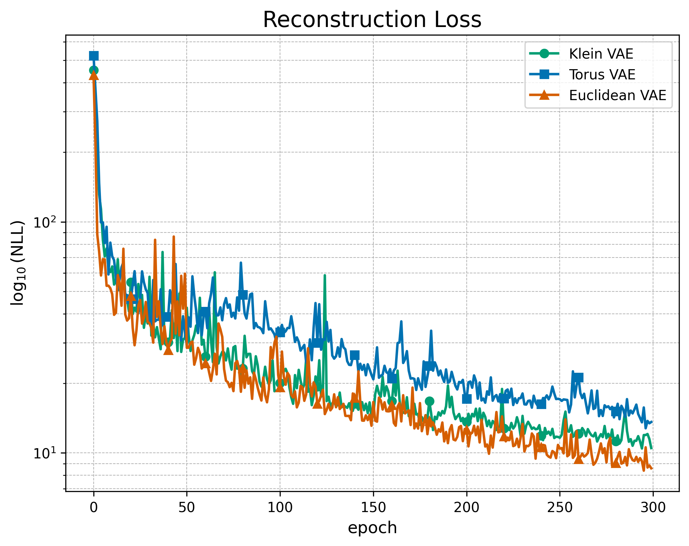
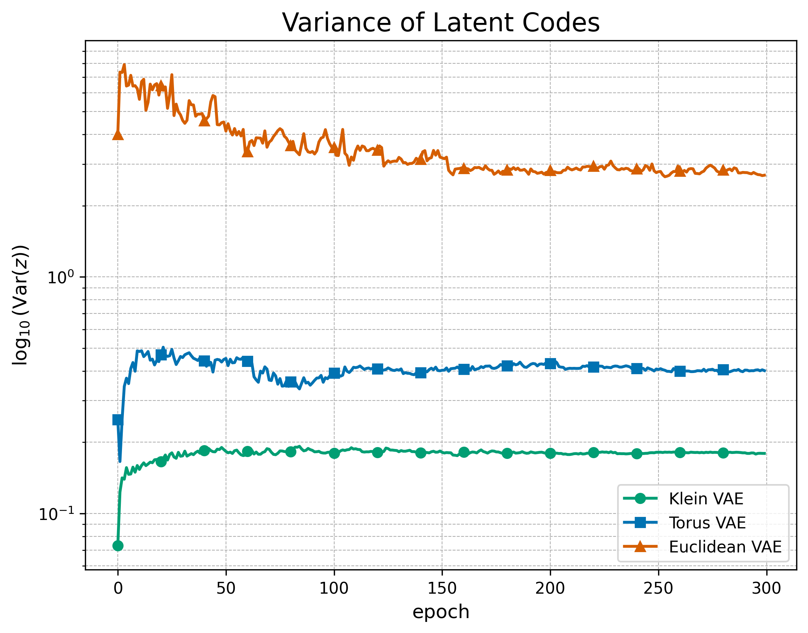
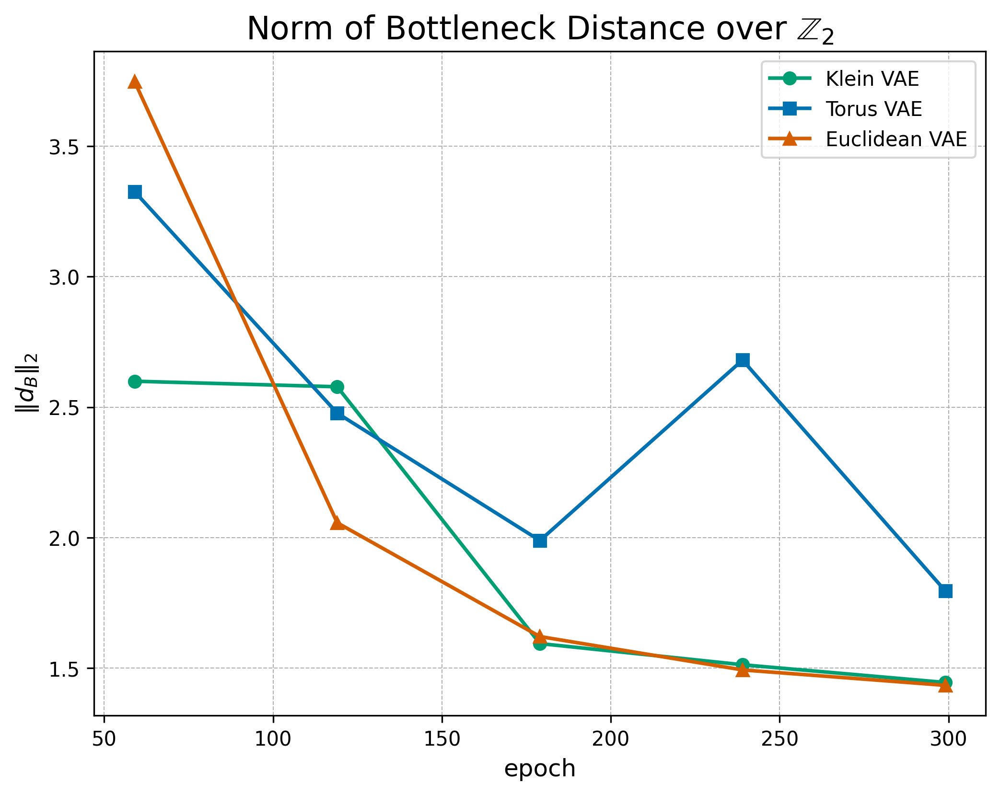
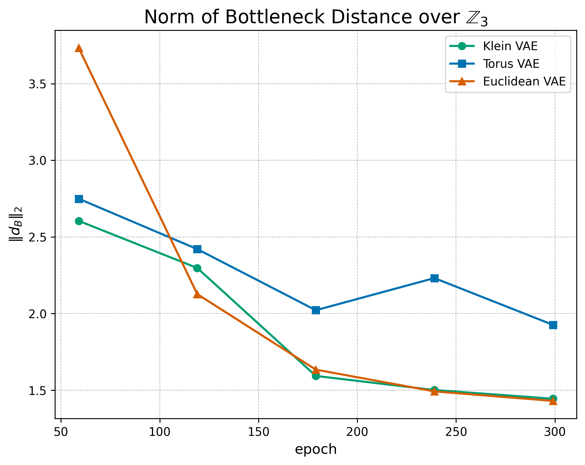

# KleinVAE

KleinVAE studies how to give a variational autoencoder a prescribed latent
geometry. It compares a Klein-bottle latent space with a torus and a Euclidean
plane on the synthetic Klein-Circles image dataset.

The encoder defines a Gaussian on a covering plane. Samples are mapped onto
the chosen surface before decoding, while the KL term is computed on the plane.
In the current implementation, invariant decoder features respect the surface’s
edge identifications.

<p align="center">
  
</p>

The torus is a two-sheeted cover of the Klein bottle: `x₁` and `x₂` map to
the same point `y`. Matching arrows indicate how edges are identified; the
dashed line divides the torus fundamental domain into two halves.

## Learning Klein-Circles

Klein-Circles consists of 100,000 binary 30×30 images of a circle of radius 0.3.
Its center is sampled uniformly on a unit square whose edges are identified as
a Klein bottle. A circle crossing an edge continues across its paired edge,
with a flip at the vertical boundary.

<p align="center">
  
</p>

**Left:** binary Klein-Circles images. **Right:** their KleinVAE reconstructions.
The grid shows how images change as the circle center moves; arrows mark the
edge identifications. White denotes intensity 1 and black intensity 0.

The curves below show a comparison of the three models over 300 epochs at
seed 27, using the same hidden widths `[1024, 512, 128, 32]` and
two-dimensional latent spaces.

### Reconstruction and latent codes

<table>
  <tr>
    <td width="50%"></td>
    <td width="50%"></td>
  </tr>
</table>

**Reconstruction.** Pixel-summed Bernoulli negative log-likelihood (NLL) measures
how well decoded images match their inputs; lower is better. In this run,
Euclidean VAE reaches the lowest loss, followed by KleinVAE and TorusVAE.

**Latent spread.** Euclidean codes spread more widely than torus and
Klein-bottle codes. This variance depends on the coordinates and domain, so a
smaller value alone does not imply a better representation. Both plots use
logarithmic vertical scales.

### Reconstruction topology

<table>
  <tr>
    <td width="50%"></td>
    <td width="50%"></td>
  </tr>
</table>

These curves compare persistence diagrams of 400 input images with those of
their reconstructions. Each score is the L2 norm of the bottleneck distances
in homology degrees 0, 1, and 2; lower means closer reconstruction topology.
The two coefficient fields, `Z/2` and `Z/3`, reveal different homological
features of the Klein bottle, so both are evaluated.

By the end of this run, KleinVAE and Euclidean VAE reach similar reconstruction
topology scores over both fields, while TorusVAE remains higher. These scores
measure the reconstructed images; they do not determine the topology of the
model's latent domain.

## Try it

Requires **Python 3.13 or newer** and **uv**. From the repository root:

```bash
uv sync
```

Run a small, one-epoch example on CPU:

```bash
uv run python main.py experiment=invariant_decoder arch=tiny logger=csv \
  data.num_images=64 data.batch_size=16 \
  trainer.min_epochs=1 trainer.max_epochs=1
```

The dataset is generated locally, and metrics and checkpoints are saved under
`logs/`. No external account is needed.

For a full training run with the current implementation:

```bash
uv run python main.py experiment=invariant_decoder arch=official logger=csv
```

Use `model=torus_vae` or `model=vanilla_vae` to try the other latent spaces.
The current configuration uses invariant decoder features and early stopping;
this command is not an exact reproduction of the fixed-length run shown above.

To run the tests:

```bash
uv run pytest
```


## Cite
```@article{Beketov2026,
  title = {Reparameterization through coverings and topological weight priors},
  volume = {2},
  ISSN = {3066-4314},
  url = {http://dx.doi.org/10.4310/DAT.260831104503},
  DOI = {10.4310/dat.260831104503},
  number = {1},
  journal = {Data Analytics and Topology},
  publisher = {International Press of Boston},
  author = {Beketov,  Maxim and Snopov,  Pavel},
  year = {2026},
  pages = {41–51}
}
```
